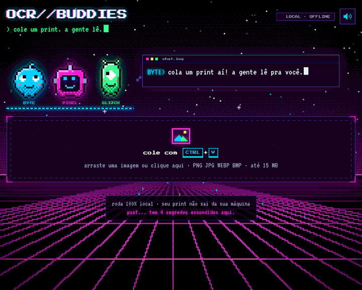

# OCR//BUDDIES

Cole um print, a gente lê. Devolve **texto** ou **tabela** (Excel/CSV), com três personagens em pixel art que comem o seu print, jogam o texto copiado um pro outro e saem correndo pra entregar o seu download.

Sem login, sem conta, sem nuvem: o OCR roda no seu computador e a imagem não é salva em lugar nenhum.



## Como usar

**Windows:** duplo clique em `iniciar.bat`. Na primeira vez ele cria o ambiente e instala as dependências; depois abre o navegador sozinho.

**Qualquer sistema:**

```bash
python -m venv .venv
# Windows: .venv\Scripts\activate    |  Linux/macOS: source .venv/bin/activate
pip install -r requirements.txt
python app.py
```

Abra http://127.0.0.1:8000 e dê **Ctrl+V** com um print na área de transferência, arraste um arquivo ou clique para escolher.

## O que ele faz

1. **Lê** a imagem com o [RapidOCR](https://github.com/RapidAI/RapidOCR) (modelo PP-OCRv6 embutido no pacote, sem baixar nada).
2. **Detecta o tipo**: se as palavras formam linhas e colunas alinhadas, abre na aba *Tabela*; senão, na aba *Texto*. Se a heurística errar, é só trocar de aba.
3. **Converte**: copiar (a tabela cola direto no Excel), baixar `.txt`, `.csv` ou `.xlsx`. As células são editáveis antes de exportar, e números no formato brasileiro (`1.234,56`) viram número de verdade no `.xlsx`.

### A turma

| | | |
|---|---|---|
| **BYTE** | a bolinha ciano | pega o texto copiado e arremessa; entrega os `.txt` |
| **PIXEL** | o robô magenta de visor LED | come o seu print; entrega os `.xlsx` |
| **GLITCH** | o alien verde de um olho só | pula pra pegar o texto no ar; entrega os `.csv` |

Os olhos seguem o mouse em passos de pixel inteiro, varrem a linha enquanto leem e acompanham qualquer coisa que esteja voando. Clique em cada um: cada personagem reage de um jeito.

Os sons são 8-bit e sintetizados na hora (WebAudio), então não há arquivo de áudio no repositório. Tem botão de mudo no canto. Com *reduzir movimento* ligado no sistema, as animações grandes são puladas e tudo continua funcionando.

<details>
<summary>4 segredos (spoiler)</summary>

- **Código Konami** (↑ ↑ ↓ ↓ ← → ← → B A): modo festa.
- Digite **matrix** fora da caixa de texto.
- Cutuque o mesmo personagem **5 vezes seguidas**.
- Fique **45 s** sem mexer em nada.

</details>

## Precisão: como ele se valida

OCR erra. O objetivo aqui é errar menos e **avisar onde pode ter errado**, em vez de entregar tudo com a mesma cara de certeza.

1. **Estrutura da tabela.** O OCR devolve cada trecho com a posição na imagem. As colunas são inferidas só das linhas com 2 ou mais trechos, contando quantas linhas ocupam cada faixa de x. Por isso título, faixa e legenda que atravessam a tabela não "colam" colunas vizinhas. Título e fonte ficam fora das células. Uma célula escrita em 2 linhas ("Consumo de / água") vira uma célula só, e a decisão compara o vão com o espaçamento típico das linhas da própria tabela.
2. **Votação com 5 leituras.** Trechos de confiança baixa, e textos curtos (onde "3" e "B" se confundem com convicção), são relidos em 4 versões da imagem: ampliada, com contraste, binarizada (Otsu) e com nitidez. Junto com a leitura original, são 5 votos e vence o texto mais repetido. Menos de 3 de 5 concordando vira **dúvida** (amarelo).
3. **Resgate de célula vazia.** Se o detector perdeu algo dentro da tabela (um "5" sozinho, por exemplo), a área da célula é recortada e lida pelos mesmos 5 caminhos (magenta).
4. **Ajustes por contexto.** "RS 1.234,56" e "R5 1.234,56" viram "R$ 1.234,56". "24.911.88" vira "24.911,88", porque número com dois pontos não existe. Em coluna com vírgula decimal, ".dd" vira ",dd". Tudo marcado (verde) e explicado no hover.
5. **Checagem de coluna.** Uma letra numa coluna de números vira dúvida com sugestão ("talvez 3 ou 8"). Nesse caso não troca sozinho.

### Medido

`python bench/benchmark.py --n 40 --seed 2026` gera tabelas difíceis com gabarito: 6 fontes, texto de 12 px, modo escuro, JPEG forte, desfoque, título, legenda e cabeçalho em 2 linhas. Valores com R$, %, datas e códigos.

| | células exatas | grade certa | tempo médio* |
|---|---|---|---|
| motor da v1 (colunas por união de intervalos) | 26,8% | 12/40 | — |
| estrutura nova | 88,1% | 40/40 | 2,2 s |
| + ajustes por contexto | 95,8% | 40/40 | 2,1 s |
| + votação de 5 leituras | **97,2%** | 40/40 | 2,8 s |

\* CPU de servidor, sem GPU. A votação custa ~0,6 s e eliminou 17 dos 41 erros que sobravam.

O que ainda erra: acento perdido em texto pequeno ("Familia"), sinal de menos colado e fonte serifada muito pequena em fundo escuro. Das células que continuaram erradas, a votação marcou só uma parte como dúvida, então **revise as tabelas importantes** mesmo sem amarelo.

## Por dentro do visual

**Personagens sem imagem.** Cada sprite é gerado por uma máscara matemática (elipse, retângulo arredondado, cápsula) numa grade de 20×22. O código calcula o contorno, a luz de borda, a sombra e o pontilhado (dithering), e junta pixels vizinhos num `<rect>` só (`static/js/buddies.js`).

**Fundo pixelado barato.** O canvas é desenhado em 1/4 da resolução e ampliado com `image-rendering: pixelated`, ou seja, 16× menos pixels por frame. Medido no Chromium headless a 1280×900: **~1,1 ms por frame em média, p95 ~3 ms**, limitado a 30 fps e pausado quando a aba fica oculta.

## Limitações

- Uma tabela por imagem. Células mescladas no meio da tabela não são reconstruídas.
- Manuscrito não é o forte do modelo.
- Sem dicionário: acento perdido não é recuperado.

## Estrutura

```
app.py              API FastAPI (/api/ocr, /api/export/csv, /api/export/xlsx) + serve o front
ocr_engine.py       OCR, votação, estrutura da tabela, ajustes e checagens
bench/benchmark.py  gerador de tabelas difíceis com gabarito + medição
static/index.html   página única
static/css/         tema cyberpunk
static/js/          main (fluxo) · buddies (sprites/olhos) · scenes (reações) · fx (partículas)
                    sound (8-bit) · background (canvas)
static/fonts/       Press Start 2P e VT323, servidas localmente (licença OFL)
samples/            imagens de exemplo (também usadas nos testes)
tests/              python -m pytest -q   (pip install pytest)
```

## Créditos e licença

Código sob licença MIT (veja [LICENSE](LICENSE)). Fontes [Press Start 2P](https://fonts.google.com/specimen/Press+Start+2P) e [VT323](https://fonts.google.com/specimen/VT323), sob a SIL Open Font License; as licenças estão em `static/fonts/`.
